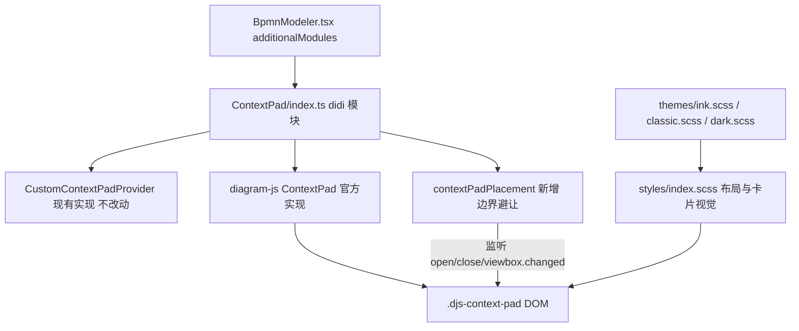

## Product Overview

重构 Flowable BPMN 设计器中「选中节点 / 流程线后弹出的操作按钮组」（bpmn-js 的 context pad）的排列方式与视觉呈现，解决按钮组排列留白、以及与流程线等画布元素视觉混杂的问题。

## Core Features

- **紧凑自动重排**：取消固定 72px 宽度与「每组独占一行」的块级换行，改为横向流式排列；某元素缺少某个操作按钮时，后续按钮自动前移，不产生空洞。
- **组间分隔**：不同语义分组（编辑 / 追加 / 连接等）在同一行内用细分隔线区分，不再靠换行留白区分。
- **浮层卡片**：按钮组整体呈现为独立浮层卡片——不透明底色、1px 描边、圆角、柔和阴影、内边距，层级高于画布内容，流程线不会再从按钮之间透出。
- **边界避让**：卡片变宽后，靠近画布右侧 / 底部时自动翻转或内收，保证按钮组完整可见、不遮挡属性面板。
- **主题一致**：ink、classic、dark 三套主题各自提供协调的卡片配色、描边、分隔线与 hover 态。
- **兼容原有行为**：节点、流程线、多选、缩放、token simulation、颜色选择器弹出层的交互与层级关系保持不变。

## Tech Stack

- 前端框架：Vue 3.5 + TypeScript + Vite 6（沿用现有）
- 样式：SCSS，全局覆盖样式集中在 `src/styles/index.scss`，主题变量在 `src/styles/themes/*`
- 画布：bpmn-js 18.6 / diagram-js 15.2（不新增依赖，不升级版本）
- 现有扩展点：`src/views/ProcessDesigner/ContextPad/` 目录下的 didi 模块

## Implementation Approach

分两层改造，互不侵入：

1. **布局与视觉层（纯 CSS）**：用 `.bjs-container .djs-context-pad` 前缀提高特异性（避免依赖 `diagram-js.css` 与全局样式的注入顺序），覆盖默认的固定宽度 72px、`.group` 块级换行、`.entry` 尺寸与阴影：

- `.djs-context-pad`：`display: flex`、`flex-wrap: wrap`、`width: max-content`、`max-width: min(320px, calc(100vw - 32px))`、`padding: 4px`、`gap`、`box-sizing: border-box`、卡片背景/描边/圆角/阴影、`z-index: 150`。
- `.djs-context-pad.open`：必须写成 `.bjs-container .djs-context-pad.open { display: flex }`，因为默认 `.djs-context-pad.open` 特异性为 (0,2,0)，与基础规则同级会依赖顺序。
- `.group`：`display: flex`、`flex-wrap: wrap`、`align-items: center`、`gap: 2px`，取消块级换行；`.group + .group` 用 `padding-left` + `border-left` 形成分隔线。
- `.entry`：26×26 热区、圆角 6px、图标 20px、`margin: 0`、去掉默认 `box-shadow`，hover 使用现有 `--context-pad-entry-hover-background-color`。
- `z-index: 150` 的取舍：高于默认 100 与 SVG 画布内容，低于 `.djs-popup`（200），保证颜色选择器 / 追加元素弹窗不被卡片遮挡。

2. **边界避让层（少量 TS）**：不继承、不覆写 diagram-js 的私有方法 `_getPosition` / `_updatePosition`（`ContextPad.d.ts` 未声明这些成员，且升级易碎）。新增 `contextPadPlacement` didi 模块，只使用公开事件与公开 API：

- 监听 `contextPad.open`（事件参数 `current.html` / `current.target`）、`contextPad.close`、`canvas.viewbox.changed`；
- 在 `requestAnimationFrame` 中测量 `pad.getBoundingClientRect()` 与 `canvas.getContainer().getBoundingClientRect()`（diagram-js 的定位在同一帧由 scheduler 写入，rAF 在其之后执行，不会闪烁；若 `pad.style.left` 仍为空则再等一帧，最多 2 次）；
- 先重置 `transform` 再测量，然后计算 `dx / dy` 并写入 `pad.style.transform = translate(dx px, dy px)`：右侧空间不足时翻转到元素左侧，底部空间不足时上移，统一保留 8px 安全边距；
- `contextPad.close` 时清除记录与内联 `transform`，避免影响下次打开。

**不做的事**：不修改 `CustomContextPadProvider.ts` 的 entries 内容与顺序（用户看到的问题来自 pad/group 布局，不是 provider）；不替换 `contextPad` 服务实现；不引入新依赖；不改动无关样式。

## Implementation Notes

- 特异性：所有覆盖规则统一加 `.bjs-container` 前缀；`.entry:hover` 需写成 `.bjs-container .djs-context-pad .entry:hover`（默认规则为 (0,3,0)）。
- 卡片必须足够不透明（ink/classic 用 `#FFFFFF`，dark 用 `var(--el-bg-color-overlay)`），必要时叠加 `backdrop-filter: blur(12px)`；纯 CSS 覆盖只作用于小小的 pad，性能开销可忽略。
- 保留 `pointer-events: none`（容器）与 `pointer-events: all`（entry），否则会拦截画布拖拽。
- 变量命名沿用现有 `--context-pad-*` 风格，新增 `--context-pad-background-color`、`--context-pad-border-color`、`--context-pad-shadow`、`--context-pad-divider-color`、`--context-pad-entry-color`；变量定义放在 `.djs-parent` 作用域内（它是 `.djs-container` 的祖先，可被子元素继承）。
- `classic.scss` 目前没有 `.djs-parent` 块，需新增；`dark.scss` 中 `--context-pad-entry-background-color: #373739` 需改为 `transparent`，让卡片统一承载底色。
- 避免回归：不改动 `.djs-palette`、`.djs-popup`、minimap、token simulation 的既有样式；不改动 bpmn-js 版本。
- 检查命令按项目规范执行：`pnpm type-check` 与 `pnpm build-only`，并如实报告结果（仓库无自动化测试，不声明测试通过）。

## Architecture Design



数据流：用户选中元素 → diagram-js `selection.changed` → `ContextPad.open()` 生成 `.djs-context-pad > .group > .entry` → CSS 决定紧凑卡片布局 → `contextPadPlacement` 在 rAF 中测量并修正越界位移 → 画布缩放时重复测量。

## Directory Structure

```
designer/
├── src/
│   ├── styles/
│   │   ├── index.scss                # [MODIFY] 新增 context pad 覆盖块：flex 紧凑布局、浮层卡片、group 分隔线、entry 热区/hover，全部以 `.bjs-container` 提高特异性
│   │   └── themes/
│   │       ├── ink.scss              # [MODIFY] 在 `html[data-theme='ink'] .djs-parent` 内新增卡片背景/描边/阴影/分隔线/图标色变量，`--context-pad-entry-background-color` 保持 transparent
│   │       ├── classic.scss          # [MODIFY] 新增 `.djs-parent` 变量块，为经典主题提供卡片配色（白底 + 浅描边 + 中性阴影）
│   │       └── dark.scss             # [MODIFY] 在 `html.dark .djs-parent` 内新增暗色卡片变量，entry 背景改为 transparent
│   └── views/ProcessDesigner/ContextPad/
│       ├── index.ts                  # [MODIFY] 在 `__init__` 与模块表注册 `contextPadPlacement`
│       └── contextPadPlacement.ts    # [NEW] 边界避让模块：监听 `contextPad.open` / `contextPad.close` / `canvas.viewbox.changed`，rAF 测量后写 `transform` 实现翻转与内收，关闭时清理
└── package.json                      # [UNCHANGED] 不新增依赖
```

## Key Code Structures

新增模块的注入契约（didi 需显式 `$inject`；仅使用公开 API）：

```ts
export default class ContextPadPlacement {
  static $inject: string[] // ['eventBus', 'canvas', 'contextPad']
  constructor(eventBus: EventBus, canvas: Canvas, contextPad: ContextPad)
}
```

依赖事件载荷：`contextPad.open` → `{ current: { html: HTMLElement; target: ContextPadTarget } }`；`canvas.viewbox.changed` 无载荷，用于重新测量。

## Design Style

紧凑浮层卡片（Compact Floating Bar）：把 context pad 从「透明图标网格」改为悬浮在画布之上的独立操作条，视觉上像一条小型工具胶囊。

- **形态**：单行自适应宽度，圆角 10px，内边距 4px，条目 26×26、条目间距 2px，整条高度约 34px；内容超出可用宽度时整组换行，不出现单行留白空洞。
- **层级**：卡片带 1px 描边与柔和外阴影（ink：`0 10px 28px rgba(27,40,56,0.14)`，classic：`0 6px 18px rgba(0,0,0,0.12)`，dark：`0 10px 30px rgba(0,0,0,0.45)`），像从画布上浮起一层，流程线在卡片下方被完全遮挡。
- **分组**：不同语义组之间用 1px 竖分隔线（高约 16px）+ 6px 间距区分，弱化但不打断整条视觉。
- **交互**：hover 时条目底色淡染主题色 8%，120ms 过渡；按下无位移，保持工具型克制感；打开/关闭沿用 diagram-js 的瞬时显隐，不加弹入动画以免拖慢操作节奏。
- **边界**：贴近画布右侧 / 底部时整体左右翻转或上移，始终保持 8px 安全边距，不超出画布、不压住右侧属性面板。
- **主题**：ink 用白底 + 冷灰描边 + 冷色阴影；classic 用纯白 + 中性灰；dark 用深灰浮层 + 高对比浅色图标。