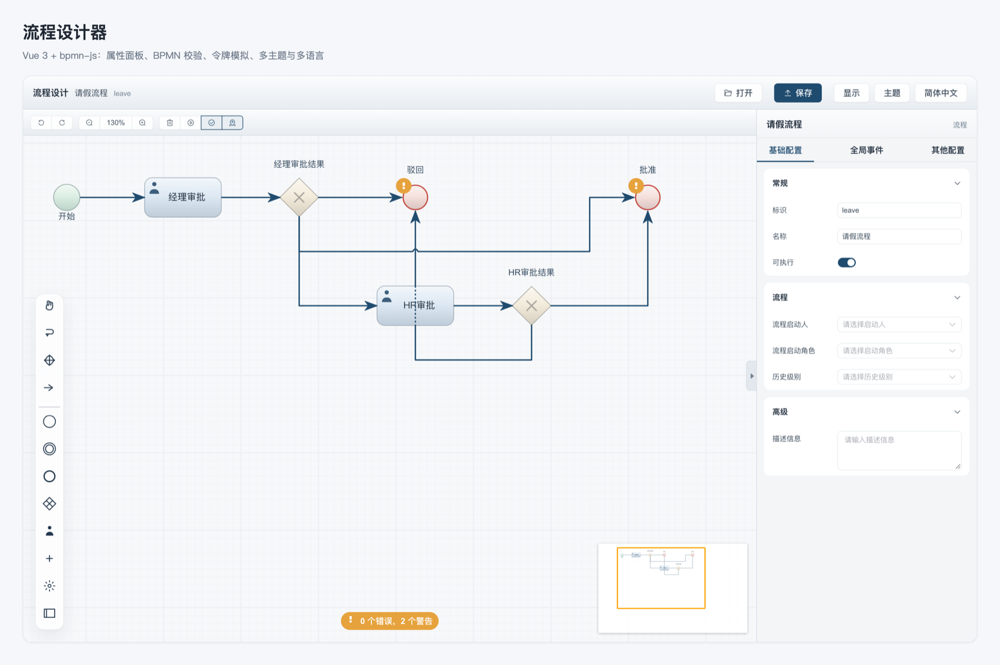
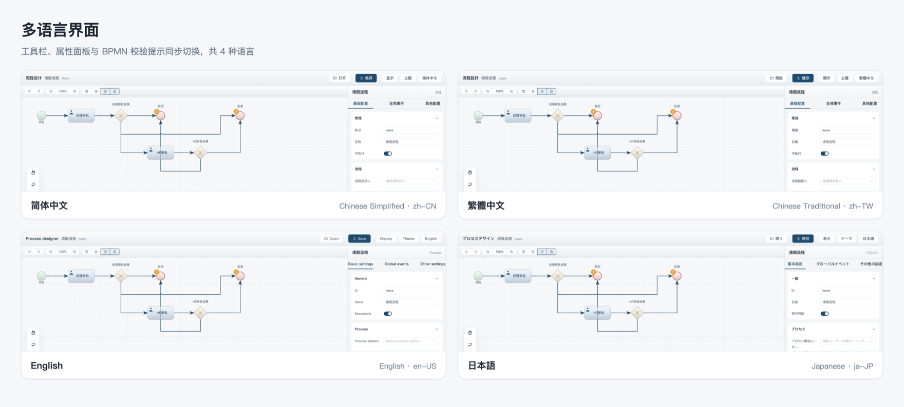
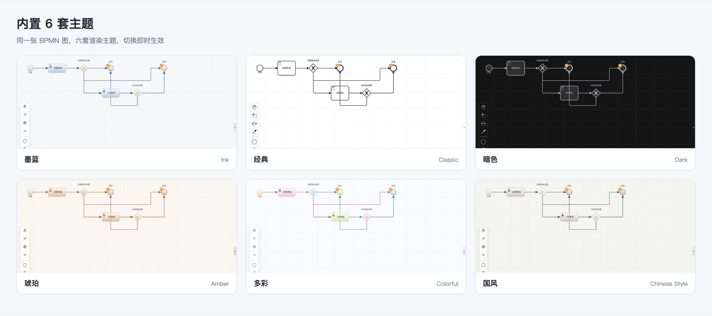

<div align="center">



# flowable-framework

A Spring Boot + Flowable 7.2 workflow backend with a built-in BPMN process designer.

[](./LICENSE)
[](https://openjdk.org/projects/jdk/21/)
[](https://spring.io/projects/spring-boot)
[](https://www.flowable.org/)
[](https://lcssos.github.io/flowable-framework/)

**[▶ Try the designer in your browser](https://lcssos.github.io/flowable-framework/)** — no install needed.

English | [简体中文](./README.zh-CN.md)

</div>

---

## Quick start

```bash
# 1. build the designer (the backend serves it from src/main/resources/static)
cd designer && pnpm install && pnpm build && cd ..

# 2. run the backend
./mvnw spring-boot:run
```

Open <http://localhost:8080> and sign in as `admin` / `test`.

> Step 1 is not optional: a fresh clone has no prebuilt frontend, so the
> backend alone would serve an empty page.

The live demo above runs the same designer as a static site — you can model,
theme, lint and simulate there, but open/save need this backend.


## Overview

`flowable-framework` is a single-module Spring Boot application that wraps
[Flowable](https://www.flowable.org/) 7.2 BPMN as a reusable workflow backend:
process deployment, process start, task inbox, history, and authentication.
It ships with an embedded leave-request process (`leave`) so the whole loop can
be exercised out of the box, plus a Vue 3 based BPMN designer in `designer/`
that talks to the backend REST facade.

## Features

- **Flowable 7.2.0 on Spring Boot 3.5.16** — process engine only, no external database required
- **REST facade** — controllers never touch engine APIs directly; services own
  `RepositoryService` / `RuntimeService` / `TaskService` / `HistoryService` / `IdentityService`
- **Sa-Token authentication** — token based login over a small `sys_user` / `sys_group` schema
- **OpenAPI docs** — springdoc at `/swagger-ui.html`
- **BPMN designer** — `designer/` provides modeling, a properties panel, BPMN lint,
  token simulation, CodeMirror script editing, and multi-theme rendering
- **HTTP-level tests** — MockMvc integration tests cover login, definitions, instances, tasks, and history

## Screenshots

The designer is the part of this project you can judge at a glance: a redesigned
UI on top of `bpmn-js`, six rendering themes, and a fully translated interface.

### Overview


Blueprint-style ink theme by default: a rounded palette rail, compact floating
context pad, card-based properties panel, and BPMN lint feedback pinned to the
canvas bottom. The screenshot is the `leave` process shipped in
`src/main/resources/processes/`.

### Multi-language UI



Four locales ship out of the box — Simplified Chinese, Traditional Chinese,
English, and Japanese. The switch covers toolbar, properties panel, palette
tooltips, context-pad captions, lint messages, and Element Plus widgets;
`bpmn-js` text is re-rendered on locale change, so no reload is needed. The
initial locale follows the browser (`zh-TW`/`zh-HK` map to Traditional, `ja`
to Japanese), and the choice is persisted in Pinia.

### Themes



| Theme | Look |
|-------|------|
| 墨蓝 Ink (default) | Cool blue ink on paper grid |
| 经典 Classic | Plain black-and-white BPMN, closest to the upstream look |
| 暗色 Dark | Dark canvas and chrome for night work |
| 琥珀 Amber | Warm brown and amber tones |
| 多彩 Colorful | Per-node color assignment across the whole diagram |
| 国风 Chinese Style | Ink-wash grays with a vermilion seal accent |

Themes are real renderer packages (`designer/src/theme/<id>`), not just CSS
variables, so element shapes and palette icons change with the palette.

## Tech stack

| Layer | Choice |
|-------|--------|
| Language | Java 21 |
| Framework | Spring Boot 3.5.16 |
| Workflow engine | Flowable 7.2.0 (`flowable-spring-boot-starter`) |
| Persistence | MyBatis-Plus + H2 (file mode, `./data/flowable`) |
| Auth | Sa-Token 1.45.0 |
| API docs | springdoc-openapi 2.8.13 |
| Frontend | Vue 3.5 + Vite 6 + TypeScript + Element Plus + bpmn-js |

## Requirements

- JDK 21
- Node.js 20+ and pnpm (frontend only)
- Maven 3.9+ (or the bundled `./mvnw`)

## Quick start

### Backend

```bash
./mvnw spring-boot:run
# or, if mvnd is installed
mvnd spring-boot:run
```

The app listens on <http://localhost:8080>. On first start a demo identity set
is seeded (`admin`, `zhangsan`, `lisi`, `wangwu`, all with password `test`) and
`src/main/resources/processes/leave.bpmn20.xml` is deployed.

### Frontend

```bash
cd designer
pnpm install
pnpm dev
```

The dev server runs at <http://localhost:5173> and proxies `/api` to
`http://localhost:8080`.

### Production build

```bash
cd designer && pnpm build      # outputs into src/main/resources/static
cd .. && ./mvnw package        # produces the runnable jar
```

## API surface

All endpoints are prefixed with `/api` and return `{ code, message, data }`
with `code = 0` on success. Everything except `/api/auth/login` requires the
`satoken` header.

| Method | Path | Purpose |
|--------|------|---------|
| `POST` | `/api/auth/login` | Log in, returns a token |
| `GET` | `/api/auth/me` | Current user |
| `GET` | `/api/process-definitions` | Latest process definitions |
| `GET` | `/api/process-definitions/{key}/model` | BPMN XML of a definition |
| `POST` | `/api/process-definitions` | Deploy BPMN XML |
| `POST` | `/api/process-definitions/{key}/start` | Start an instance |
| `GET` | `/api/process-instances` | Running instances (paged) |
| `GET` | `/api/process-instances/{id}` | Instance detail |
| `POST` | `/api/process-instances/{id}/delete` | Delete an instance |
| `GET` | `/api/tasks` | My task inbox (paged) |
| `POST` | `/api/tasks/{id}/claim` | Claim a task |
| `POST` | `/api/tasks/{id}/complete` | Complete a task |
| `GET` | `/api/history/process-instances` | Historic instances (paged) |
| `GET` | `/api/history/process-instances/{id}/activities` | Historic activities |

## Project layout

```text
├── src/main/java/com/example/flowable
│   ├── common/      # ApiResponse, error codes, global exception handling, paging
│   ├── config/      # Sa-Token interceptor, identity seed, OpenAPI
│   ├── identity/    # users, groups, current user, login
│   └── workflow/    # definitions, instances, tasks, history
├── src/main/resources
│   ├── processes/   # deployable BPMN definitions
│   └── schema/      # sys_user / sys_group DDL
├── src/test/java    # MockMvc integration tests
├── designer/        # Vue 3 BPMN designer (see designer/README.md)
└── docs/            # design notes and implementation plans
```

## Tests

```bash
./mvnw test        # or: mvnd -o test
```

The test suite runs against an in-memory H2 database and needs no external services.

## License

Licensed under the [Apache License 2.0](./LICENSE).

The `designer/` subtree is derived from the open-source project
**vue-bpmn-designer** by tsai996
(<https://github.com/tsai996/vue-bpmn-designer>, Apache-2.0). Its original
license text is kept verbatim in [`designer/LICENSE`](./designer/LICENSE) and
the upstream attribution is recorded in [`NOTICE`](./NOTICE). Any downstream
use of `designer/` must keep those notices intact.
