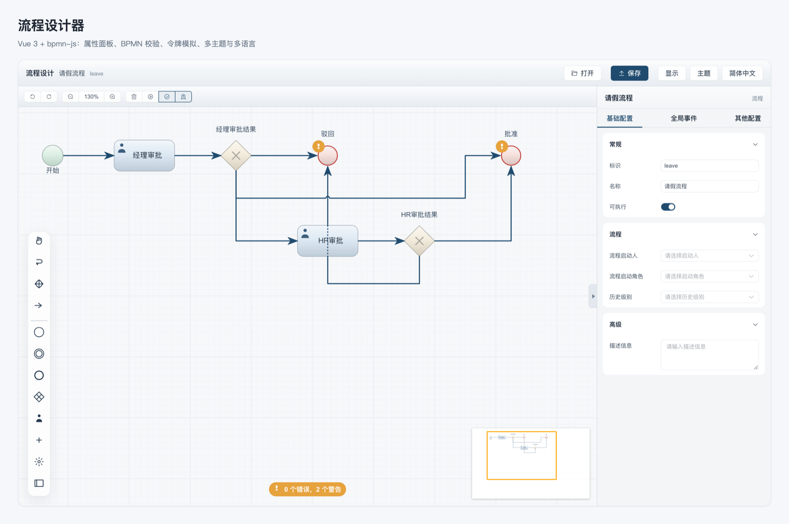
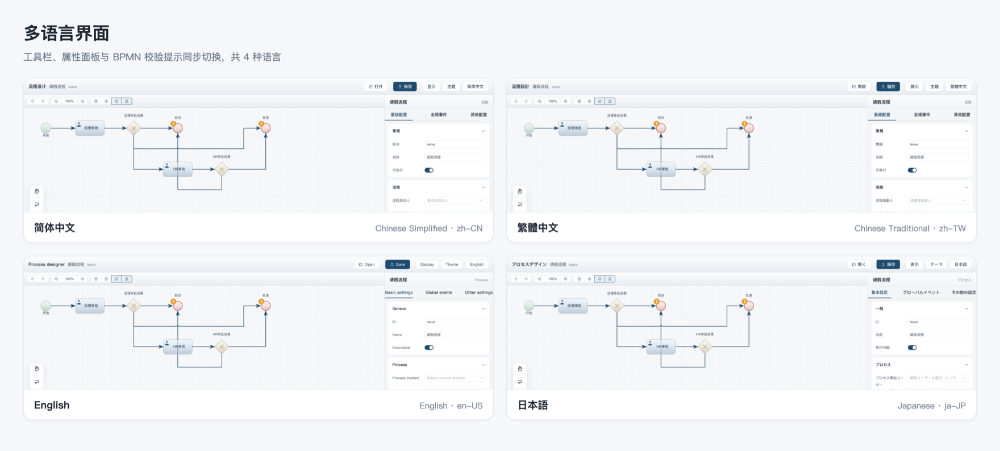
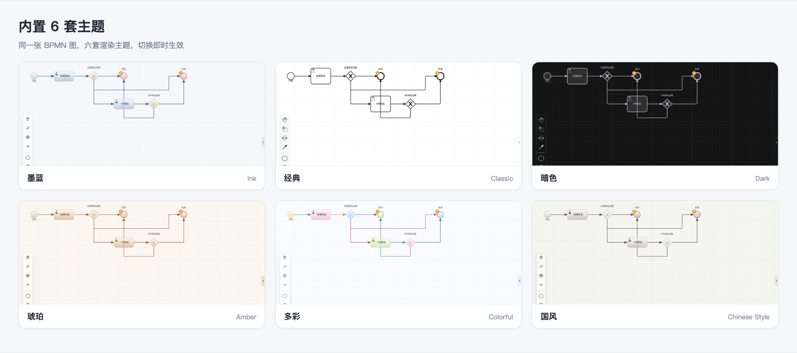

<div align="center">

# flowable-framework

基于 Spring Boot + Flowable 的工作流框架，内置 BPMN 流程设计器。

[English](./README.md) | 简体中文

</div>

---

## 项目简介

`flowable-framework` 是一个单模块 Spring Boot 应用，把 [Flowable](https://www.flowable.org/)
7.2 的 BPMN 能力封装成可复用的工作流后端：流程部署、流程发起、待办任务、历史查询与登录认证。
仓库自带一个请假流程（`leave`），开箱即可跑通完整闭环；`designer/` 目录是基于 Vue 3 的
BPMN 设计器，直接对接后端的 REST 接口。

## 特性

- **Flowable 7.2.0 + Spring Boot 3.5.16** —— 只引入流程引擎，无需外部数据库
- **REST 门面** —— Controller 不直接调用引擎 API，由 service 层统一持有
  `RepositoryService` / `RuntimeService` / `TaskService` / `HistoryService` / `IdentityService`
- **Sa-Token 认证** —— 基于 `sys_user` / `sys_group` 两张表实现令牌登录
- **OpenAPI 文档** —— springdoc，访问 `/swagger-ui.html`
- **BPMN 设计器** —— `designer/` 提供建模、属性面板、BPMN 校验、令牌模拟、
  CodeMirror 脚本编辑与多主题渲染
- **HTTP 级测试** —— 基于 MockMvc 的集成测试覆盖登录、流程定义、实例、任务与历史

## 界面截图

设计器是本工程一眼可见的部分：在 `bpmn-js` 之上重做的界面、6 套渲染主题、以及完整可切换的多种语言。

### 整体界面



默认的墨蓝（ink）主题：圆角工具条、紧凑浮层操作卡片、卡片式属性面板，
BPMN 校验结果常驻画布底部。图中流程即仓库自带的请假流程（`src/main/resources/processes/`）。

### 多语言界面



内置 4 种语言 —— 简体中文、繁體中文、English、日本語。切换范围覆盖工具栏、属性面板、
Palette 提示、操作卡片文案、BPMN 校验提示以及 Element Plus 组件；`bpmn-js` 的界面文案
在语言切换时主动重建，无需刷新页面。首次进入按浏览器语言判定（`zh-TW`/`zh-HK` 走繁体、
`ja` 走日文），选择结果通过 Pinia 持久化。

### 主题



| 主题 | 风格 |
|------|------|
| 墨蓝 Ink（默认） | 冷蓝墨色，纸面网格 |
| 经典 Classic | 黑白线框，最接近上游原版 |
| 暗色 Dark | 深色画布与深色外框，适合夜间使用 |
| 琥珀 Amber | 暖棕与琥珀色调 |
| 多彩 Colorful | 按节点分配配色，整图彩色 |
| 国风 Chinese Style | 水墨灰调，朱红印章式点缀 |

主题不是简单的 CSS 变量替换，而是独立的渲染包（`designer/src/theme/<id>`），
节点绘制与 Palette 图标都会跟着换。

## 技术栈

| 层次 | 选型 |
|------|------|
| 语言 | Java 21 |
| 框架 | Spring Boot 3.5.16 |
| 流程引擎 | Flowable 7.2.0（`flowable-spring-boot-starter`） |
| 持久化 | MyBatis-Plus + H2（文件模式，`./data/flowable`） |
| 认证 | Sa-Token 1.45.0 |
| 接口文档 | springdoc-openapi 2.8.13 |
| 前端 | Vue 3.5 + Vite 6 + TypeScript + Element Plus + bpmn-js |

## 环境要求

- JDK 21
- Node.js 20+ 与 pnpm（仅前端需要）
- Maven 3.9+（或直接使用仓库自带的 `./mvnw`）

## 快速开始

### 后端

```bash
./mvnw spring-boot:run
# 或本机已装 mvnd 时
mvnd spring-boot:run
```

服务监听 <http://localhost:8080>。首次启动会初始化演示账号
（`admin`、`zhangsan`、`lisi`、`wangwu`，密码均为 `test`），
并自动部署 `src/main/resources/processes/leave.bpmn20.xml`。

### 前端

```bash
cd designer
pnpm install
pnpm dev
```

开发服务器运行在 <http://localhost:5173>，`/api` 会代理到 `http://localhost:8080`。

### 生产构建

```bash
cd designer && pnpm build      # 产物输出到 src/main/resources/static
cd .. && ./mvnw package        # 打出可运行 jar
```

## 接口一览

所有接口统一前缀 `/api`，返回 `{ code, message, data }`，`code = 0` 表示成功。
除 `/api/auth/login` 外，其余接口都需要携带 `satoken` 请求头。

| 方法 | 路径 | 说明 |
|------|------|------|
| `POST` | `/api/auth/login` | 登录，返回令牌 |
| `GET` | `/api/auth/me` | 当前登录用户 |
| `GET` | `/api/process-definitions` | 最新版本流程定义 |
| `GET` | `/api/process-definitions/{key}/model` | 流程定义的 BPMN XML |
| `POST` | `/api/process-definitions` | 部署 BPMN XML |
| `POST` | `/api/process-definitions/{key}/start` | 发起流程实例 |
| `GET` | `/api/process-instances` | 运行中实例（分页） |
| `GET` | `/api/process-instances/{id}` | 实例详情 |
| `POST` | `/api/process-instances/{id}/delete` | 删除实例 |
| `GET` | `/api/tasks` | 我的待办（分页） |
| `POST` | `/api/tasks/{id}/claim` | 签收任务 |
| `POST` | `/api/tasks/{id}/complete` | 完成任务 |
| `GET` | `/api/history/process-instances` | 历史实例（分页） |
| `GET` | `/api/history/process-instances/{id}/activities` | 历史节点流转 |

## 目录结构

```text
├── src/main/java/com/example/flowable
│   ├── common/      # ApiResponse、错误码、全局异常处理、分页
│   ├── config/      # Sa-Token 拦截器、身份初始化、OpenAPI
│   ├── identity/    # 用户、用户组、当前用户、登录
│   └── workflow/    # 流程定义、实例、任务、历史
├── src/main/resources
│   ├── processes/   # 可部署的 BPMN 流程定义
│   └── schema/      # sys_user / sys_group 建表脚本
├── src/test/java    # MockMvc 集成测试
├── designer/        # Vue 3 BPMN 设计器（详见 designer/README.zh-CN.md）
└── docs/            # 设计说明与实施计划
```

## 测试

```bash
./mvnw test        # 或：mvnd -o test
```

测试使用内存 H2 数据库，不依赖任何外部服务。

## 开源协议

本项目基于 [Apache License 2.0](./LICENSE) 开源。

`designer/` 目录派生自开源项目 **vue-bpmn-designer**（作者 tsai996，
<https://github.com/tsai996/vue-bpmn-designer>，Apache-2.0）。其原始协议文本完整保留在
[`designer/LICENSE`](./designer/LICENSE)，上游署名信息记录在 [`NOTICE`](./NOTICE)。
下游使用 `designer/` 时必须保留这些声明。
